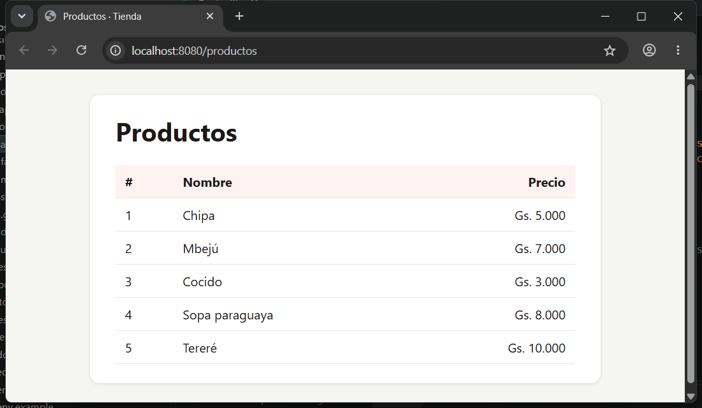

# Tienda · Laravel + Docker

Proyecto Laravel que corre en contenedores: PHP 8.4 + Apache, MySQL 8 y phpMyAdmin. No hace falta tener PHP, Composer ni MySQL instalados, solo Docker Desktop.

Repositorio: https://github.com/joi-man/tienda.git

## Servicios

| Servicio | URL / puerto | Descripción |
| --- | --- | --- |
| `app` | http://localhost:8080 | Laravel (PHP 8.4 + Apache) |
| `db` | `127.0.0.1:3308` | MySQL 8, base `laravel` (usuario `root`, clave `secreto`) |
| `phpmyadmin` | http://localhost:8081 | Administración de la base (usuario `root`, clave `secreto`) |

## Puesta en marcha

```bash
git clone https://github.com/joi-man/tienda.git
cd tienda
cp .env.example .env
docker compose up -d --build
docker compose exec app composer install
docker compose exec app php artisan key:generate
chmod -R 777 storage bootstrap/cache
# esperar ~30 segundos a que arranque MySQL
docker compose exec app php artisan migrate --seed
```

Luego abrir:

- http://localhost:8080/productos → lista de productos en guaraníes
- http://localhost:8081 → phpMyAdmin

## Comandos usados

```bash
docker compose exec app php artisan make:model Producto -mcrs
docker compose exec app php artisan migrate --seed
```

## Tablas (en español)

`productos` (columnas `nombre`, `precio`, `creado_en`, `actualizado_en`), `usuarios`, `sesiones`, `tokens_restablecer_contrasena`, `cache`, `bloqueos_cache`, `trabajos`, `lotes_trabajos`, `trabajos_fallidos` y `migraciones`.

## Apagar y volver

```bash
docker compose down        # los datos quedan en el volumen datos_db
docker compose up -d
docker compose down -v     # borra también la base (¡cuidado!)
```

## Captura



## ¿Por qué `PMA_HOST` es `db` y no `localhost`?

Cada contenedor tiene su propia red y su propio `localhost`. Dentro del contenedor de phpMyAdmin, `localhost` apunta al propio phpMyAdmin, donde no hay ningún MySQL. Docker Compose pone todos los servicios en una red común y usa el **nombre del servicio** como nombre de host, así que `db` resuelve a la IP del contenedor de MySQL. Por la misma razón el `.env` usa `DB_HOST=db`.
